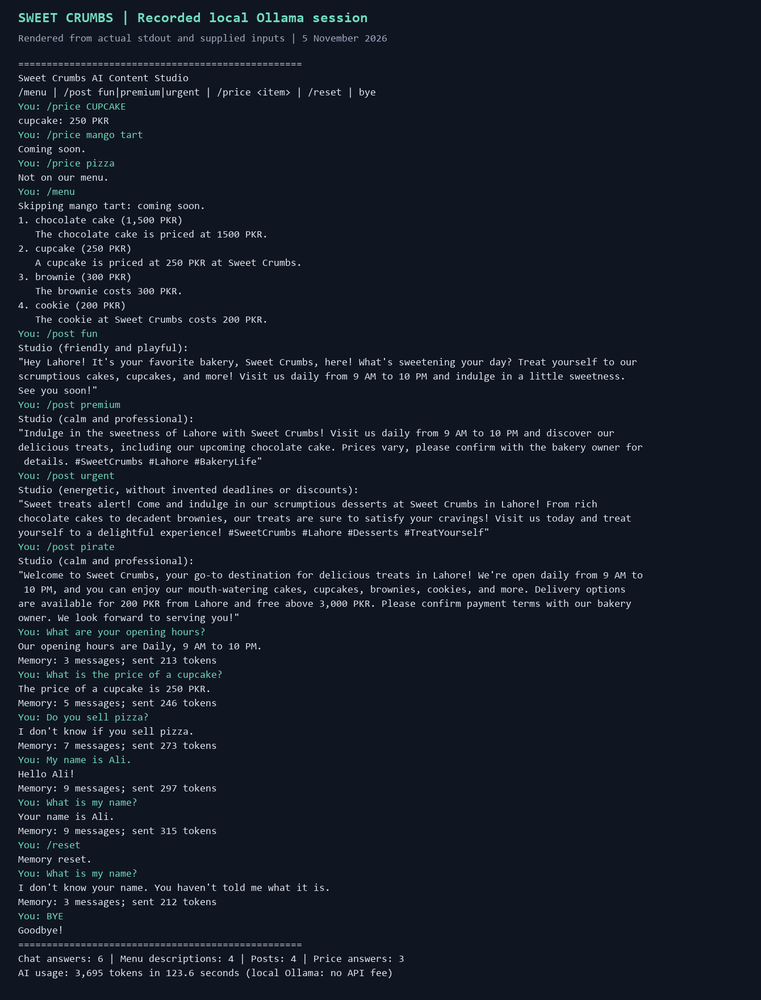
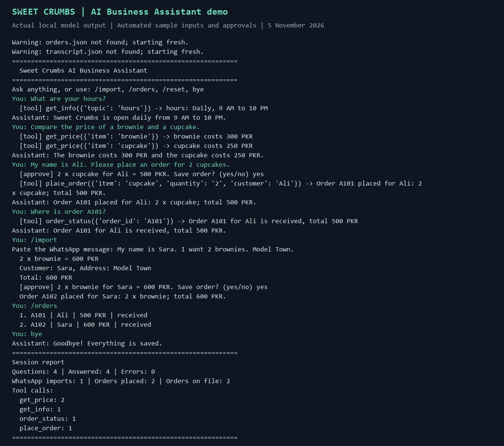

# Python for AI

## AI Content Studio (Module 2, Checkpoint 1)

Batch service descriptions, streamed marketing posts, exact price lookups and
customer chat with memory for Sweet Crumbs. This saves the owner repeated copywriting
and customer FAQ work; value depends on reviewing the generated copy.

```powershell
uv run code/project_m2_content_studio.py
```

Design: [project notes](docs/project-m2-cp1-design.md).
Validation: [actual results and demo checklist](docs/project-m2-cp1-results.md).



*Session image rendered from the real local Ollama output and supplied commands.*

**Name:** Muhammad Waleed  
**Course:** Python for AI - GenAI and Agentic AI

## About Me

I am learning Python and want to become an AI Developer. My goal is to build AI tools that can solve real business problems and make daily tasks easier.

## About This Repository

This repository contains my Python practice code and assignments from the Python for AI course.

## Tools I Use

- Python
- VS Code
- Git and GitHub
- uv
- Ollama
- Claude Code

## How to Run

First, open the project folder in your terminal.

To run the main file:

`uv run main.py`

To run Lesson 1.1:

`uv run code/lesson_01_intro.py`

To run Lesson 1.2:

`uv run code/lesson_02_toolkit.py`

## Lessons Completed

- Lesson 1.1 - My AI Career Intro
- Lesson 1.2 - Toolkit Proof
- Lesson 1.3 - Client-Ready Repo
- Lessons 1.4-1.8 - Prompt builder, model profile, prompt cleaner, router and business bot
- Lessons 2.1-2.8 - AI calls, memory, personas, batch writing, skills, files, extraction and tools
- Lessons 3.1-3.4 - Organised agent, nested validated orders, live APIs and document loading

## My Learning Goal

I want to improve my Python skills to build AI agents and automation tools.


## Lesson 1.8 — Business Helper Bot

**Business:** Sweet Crumbs (Demo Bakery)

### Intent Design Table

| Intent | Keywords | Bot Response |
|---|---|---|
| Greeting | hi, hello, hey, salam | Personalized greeting |
| Opening Hours | hour, open, time | Open daily 9 AM–10 PM |
| Prices | price, cost, how much | Example product prices |
| Location | where, location, address | Demo shop based in Lahore |
| Orders | order, delivery | Ordering and delivery guidance |
| Complaints | refund, complaint, late, damaged | Apology and manager referral |
| Human Handover | human, agent | Simulated human handover |
| Exit | bye, exit | Goodbye and chat summary |
| Fallback | Unknown question | Generate a future AI prompt |

### Features

- Customer name memory
- Multiple messages using `while True`
- Case-insensitive intent detection
- Complaint-first routing
- Human handover (stretch goal)
- Complaint counter (stretch goal)
- AI fallback prompt for Module 2
- Final conversation summary

### Run

```powershell
uv run .\code\lesson_08_mini_chatbot.py
```

**Note:** Shop prices, opening hours, and location are fictional examples.

## Module 2 Final Project — AI Business Assistant

### Project Overview

**Sweet Crumbs AI Business Assistant** is a Python and LangChain-based AI agent that helps a bakery answer customer questions, check orders, process WhatsApp order messages, and maintain business records.

The assistant reads business information from `business.json` and requires owner approval before saving orders.

### Features

- Answers customer questions using official business information.
- Looks up bakery item prices without inventing amounts.
- Checks existing orders.
- Places new orders after owner approval.
- Extracts structured orders from WhatsApp messages.
- Saves orders and conversation history in JSON files.
- Handles errors and generates a session report.

### How to Run

```powershell
cd code
uv run project_m2_business_assistant.py
```

Make sure Ollama is running and the `llama3.2` model is installed.

### AI Tools

| Tool | Description |
|---|---|
| `get_price` | Reads bakery item prices from `business.json` |
| `get_info` | Reads working hours, delivery information and other business details |
| `order_status` | Checks order status from saved orders |
| `place_order` | Calculates the total in Python and requests owner approval before saving |

### Commands

| Command | Purpose |
|---|---|
| `/import` | Extract a structured order from a WhatsApp message |
| `/orders` | Display saved orders |
| `/reset` | Clear conversation history without deleting orders |
| `bye` | Exit and display the session report |

### Project Screenshot



*Recorded demo session rendered from actual local output and supplied inputs.*

### Business Value

This assistant saves the business owner time by automating repetitive customer questions, price inquiries, and order recording. A business could pay a monthly maintenance fee for keeping its information updated, monitoring errors, and supporting its customer-service workflow.

### Technology Stack

Python, LangChain, Ollama, Pydantic, JSON, and uv.


## Module 3 - RAG preparation and tools

The package is named `code/sweet_crumbs/`, matching the lesson example. All bakery
facts and prices are samples in `code/business.json`; they are not real client data.

| Lesson | Run from the repository root |
|---|---|
| Updated 2.8 (`create_agent`) | `uv run code/lesson_2_8_first_agent_v2.py` |
| 3.1 - Organised agent | `uv run code/lesson_3_1_agent.py` |
| 3.2 - Nested order models | `uv run code/lesson_3_2_order_models.py` |
| 3.3 - Live API tools | `uv run code/lesson_3_3_live_agent.py` |
| 3.4 - Document loader | `uv run code/lesson_3_4_loader.py` |

Run `uv sync` first. Local defaults use Ollama and `llama3.2`; no API key is needed.
Settings can be changed by copying `.env.example` to `.env`. Never commit real keys.

From `code/`, run `uv run python -m sweet_crumbs.pricing`,
`uv run python -m sweet_crumbs.models`, `uv run python -m sweet_crumbs.api`, and
`uv run python -m sweet_crumbs.loader` for the embedded checks. The API checks
simulate an offline connection and verify retries/cache without using the internet.

`knowledge/` contains the required sample text, Markdown and PDF documents.
The loader reports unreadable/scanned pages, keeps each chunk's source and page,
and saves ignored `code/chunks.json` for the next RAG lesson. Use your own private
folder with `uv run code/lesson_3_4_loader.py C:/path/to/knowledge`.

Approved Module 3 orders and extracted candidates use separate ignored files
(`module3_orders.json` and `module3_extracted_orders.json`) so the earlier final
project's `orders.json` is preserved. Extraction never confirms an order; only
terminal owner approval can do that. Old software-demo records are preserved
locally with `.before-sweet-crumbs` filenames and are ignored by Git.

The live tools provide exchange rates (Rates by Exchange Rate API) and Lahore
weather (Open-Meteo, non-commercial demo). Tools report connection errors safely.
The original Lesson 2.8 keeps the manual loop required by its assessment; the v2
script demonstrates the updated `create_agent` loop and checkpoint memory.

Coding stretch exercises: `lesson_2_4_bot_battle.py`, `/add` in the persona bot,
`/batch` in the skills toolkit, `/export` in the saved bot, CSV export in the order
extractor, and `uv run code/project_m1_prompt_kit.py --ai` for the AI marketing answer.

The fetched upstream contains lessons 3.1-3.4 but no Module 3 assessment files.
This implements their available coding tasks. Quick-check answers, class demos,
commits and GitHub pushes are left to the student.
