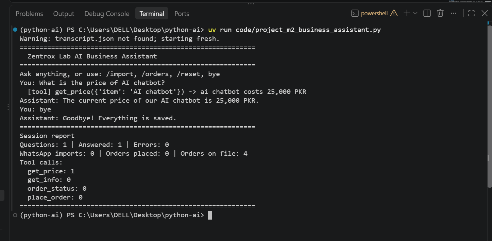

# Python for AI

**Name:** Muhammad Waleed  
**Course:** Python for AI - GenAI and Agentic AI

## About Me

I am learning Python and want to become an AI Developer. My goal is to build AI tools that can solve real business problems and make daily tasks easier.

## About This Repository

This repository contains my Python practice code and assignments from the Python for AI course.

## Tools I Use

- Python
- VS Code
- Git and GitHub
- uv
- Ollama
- Claude Code

## How to Run

First, open the project folder in your terminal.

To run the main file:

`uv run main.py`

To run Lesson 1.1:

`uv run code/lesson_01_intro.py`

To run Lesson 1.2:

`uv run code/lesson_02_toolkit.py`

## Lessons Completed

- Lesson 1.1 - My AI Career Intro
- Lesson 1.2 - Toolkit Proof
- Lesson 1.3 - Client-Ready Repo

## My Learning Goal

I want to improve my Python skills to build AI agents and automation tools.


## Lesson 1.8 — Business Helper Bot

**Business:** City Mart (Demo Local Shop)

### Intent Design Table

| Intent | Keywords | Bot Response |
|---|---|---|
| Greeting | hi, hello, hey, salam | Personalized greeting |
| Opening Hours | hour, open, time | Open daily 9 AM–10 PM |
| Prices | price, cost, how much | Example product prices |
| Location | where, location, address | Demo shop based in Lahore |
| Orders | order, delivery | Ordering and delivery guidance |
| Complaints | refund, complaint, late, damaged | Apology and manager referral |
| Human Handover | human, agent | Simulated human handover |
| Exit | bye, exit | Goodbye and chat summary |
| Fallback | Unknown question | Generate a future AI prompt |

### Features

- Customer name memory
- Multiple messages using `while True`
- Case-insensitive intent detection
- Complaint-first routing
- Human handover (stretch goal)
- Complaint counter (stretch goal)
- AI fallback prompt for Module 2
- Final conversation summary

### Run

```powershell
uv run .\code\lesson_08_mini_chatbot.py
```

**Note:** Shop prices, opening hours, and location are fictional examples.

## Module 2 Final Project — AI Business Assistant

### Project Overview

**Zentrox Lab AI Business Assistant** is a Python and LangChain-based AI agent that helps a software development business answer customer questions, check orders, process WhatsApp order messages, and maintain business records.

The assistant reads business information from `business.json` and requires owner approval before saving orders.

### Features

- Answers customer questions using official business information.
- Looks up service prices without inventing amounts.
- Checks existing orders.
- Places new orders after owner approval.
- Extracts structured orders from WhatsApp messages.
- Saves orders and conversation history in JSON files.
- Handles errors and generates a session report.

### How to Run

```powershell
cd code
uv run project_m2_business_assistant.py
```

Make sure Ollama is running and the `llama3.2` model is installed.

### AI Tools

| Tool | Description |
|---|---|
| `get_price` | Reads service prices from `business.json` |
| `get_info` | Reads working hours, delivery information and other business details |
| `order_status` | Checks order status from saved orders |
| `place_order` | Calculates the total in Python and requests owner approval before saving |

### Commands

| Command | Purpose |
|---|---|
| `/import` | Extract a structured order from a WhatsApp message |
| `/orders` | Display saved orders |
| `/reset` | Clear conversation history without deleting orders |
| `bye` | Exit and display the session report |

### Project Screenshot



*Screenshot will be added after the full session is captured.*

### Business Value

This assistant saves the business owner time by automating repetitive customer questions, price inquiries, and order recording. A business could pay a monthly maintenance fee for keeping its information updated, monitoring errors, and supporting its customer-service workflow.

### Technology Stack

Python, LangChain, Ollama, Pydantic, JSON, and uv.
