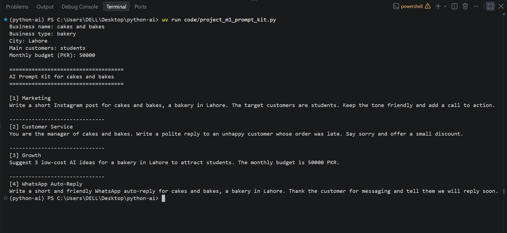

# Module 1 Project: AI Test Results

**Business:** cakes and bakes  
**Business Type:** bakery  
**City:** Lahore  
**Main Customers:** Students  
**Monthly Budget:** 50000 PKR  
**Model:** gemma3:270m

## Prompt 1: Marketing

**Prompt:**

Write a short Instagram post for cakes and bakes, a bakery in Lahore. The target customers are Students. Keep the tone friendly and add a call to action.

**AI Answer:**

✨ **Lahore Calling!** ✨

Looking for a delicious and beautiful cake and bake? 🍰🍰🍰

Come on down to [Bakery Name] in Lahore! We're serving up mouthwatering cakes and delicious treats for all occasions. 🥳

Whether you're celebrating a special occasion or just want to brighten someone's day, we've got something for you!

✨ **Call to Action:**  Come visit us today and treat yourself! ➡️ [Link to Website/QR Code] #LahoreBakery #CakeAndBake #StudentCake #LahoreFood #Delicious #BakeryLife

**Useful?**

Yes, but it needs some editing. The AI created a friendly Instagram post, but it did not use the actual bakery name.

---

## Prompt 2: Customer Service

**Prompt:**

You are the manager of cakes and bakes. Write a polite reply to an unhappy customer whose order was late. Say sorry and offer a small discount.

**AI Answer:**

Dear [Customer Name],

I am so sorry to hear about the delay in your order. We understand your frustration and sincerely apologize for the inconvenience this has caused.

We value your business and are working hard to resolve this issue as quickly as possible.

To help us understand the situation better, could you please provide a little more information about the reason for the delay? This will help us improve our processes and prevent similar issues in the future.

Thank you for your understanding. We appreciate your patience.

Sincerely,

[Your Name]
Manager, [Bakery Name]

**Useful?**

Partially. The reply is polite, but the AI did not offer a discount as requested. It also did not use the actual bakery name.

---

## Prompt 3: Growth

**Prompt:**

Suggest 3 low-cost AI ideas for a bakery in Lahore to attract Students. The monthly budget is 50000 PKR.

**AI Answer:**

Here are 3 low-cost AI ideas for a bakery in Lahore to attract students:

1.  **AI-Powered Recipe Recommendation Engine:**
    *   **Concept:** Utilize AI to suggest delicious and easy-to-make cakes and pastries based on customer preferences, dietary restrictions, and available ingredients.
    *   **Implementation:** Integrate with a food delivery platform (like Grubhub or Uber Eats) or a recipe API.
    *   **Pros:** Saves time and effort, provides personalized recommendations, generates leads, and can be easily customized.
    *   **Monetization:** Commission from delivery services, partnerships with local businesses.

2.  **AI-Driven Social Media Content Creation:**
    *   **Concept:** Create engaging and informative content for social media platforms (Instagram, TikTok, Facebook) to showcase your bakery's offerings, highlight promotions, and share customer testimonials.
    *   **Implementation:** Use AI tools to analyze social media trends, understand customer preferences, and create visually appealing and engaging content.
    *   **Pros:** Boosts brand awareness, generates leads, and drives traffic to your website/online store.
    *   **Monetization:** Commission from social media advertising, partnerships with local influencers, and selling your own digital products.

3.  **AI-Powered Customer Service Chatbot:**
    *   **Concept:** Develop a chatbot that can answer customer inquiries about your bakery, provide order updates, and handle simple requests.
    *   **Implementation:** Integrate with a customer service platform (like Zendesk or Intercom) and have a chatbot trained to handle various customer inquiries.
    *   **Pros:** Provides instant customer support, reduces response times, and handles a large volume of inquiries efficiently.
    *   **Monetization:** Commission from customer service platforms, partnerships with local businesses.

Remember to focus on providing excellent customer service and building relationships with your customers!

**Useful?**

Partially. The AI suggested three ideas, but it did not explain their costs or how they fit within the 50000 PKR budget.

---

## Prompt 4: WhatsApp Auto-Reply (Bonus)

**Prompt:**

Write a short and friendly WhatsApp auto-reply for cakes and bakes, a bakery in Lahore. Thank the customer for messaging and tell them we will reply soon.

**AI Answer:**

Hi [Customer Name],

Thank you so much for reaching out to us! We're so happy to help you with your order. We'll be sure to reply to your message soon.

Warmly,

The [Bakery Name] Team

**Useful?**

Yes. The reply is short and friendly.

## Module 1 Project: AI Prompt Kit

This is my Python project for Module 1. It creates AI prompts for small businesses.

The program takes business name, business type, city, target customers, and monthly budget as input.

It generates 4 prompts:

1. Marketing
2. Customer Service
3. Business Growth
4. WhatsApp Auto-Reply

### How to Run

`uv run code/project_m1_prompt_kit.py`

### AI Testing

I tested all 4 prompts using Ollama with the `gemma3:270m` model.

The actual AI responses and my reviews are saved in `docs/project-m1-results.md`.

### Screenshot

### Screenshot

### Who Would Pay for This?

Small business owners who want to use AI but don't know how to write good prompts.

### What I Learned

I learned how to use Python variables, input, print, f-strings, and integers. I also learned how to test AI prompts and review their answers.

